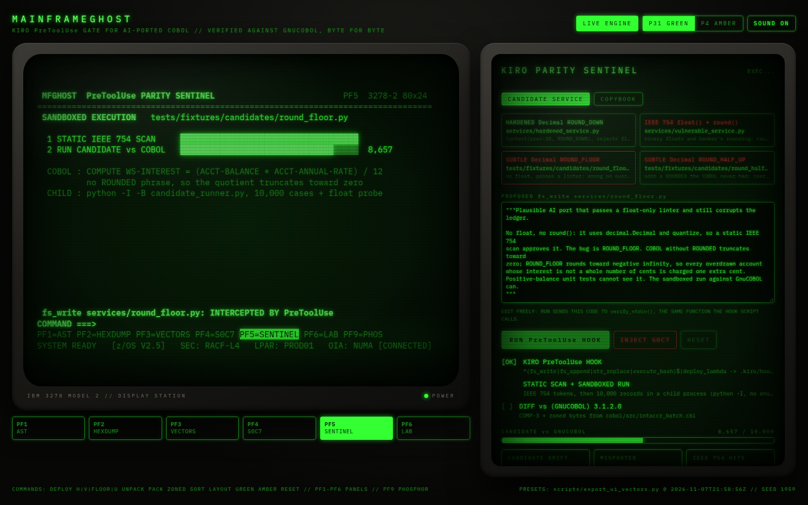
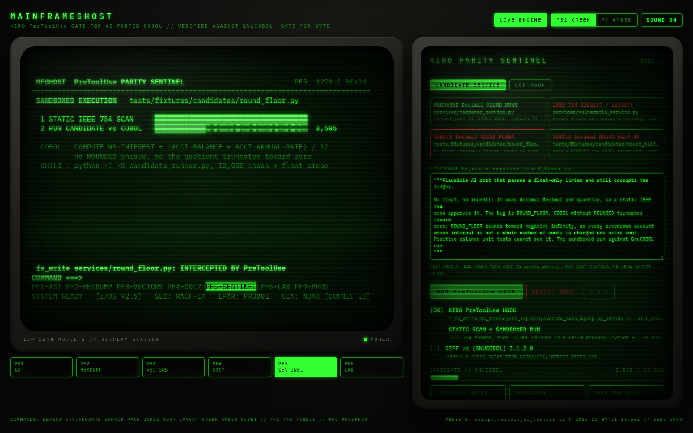
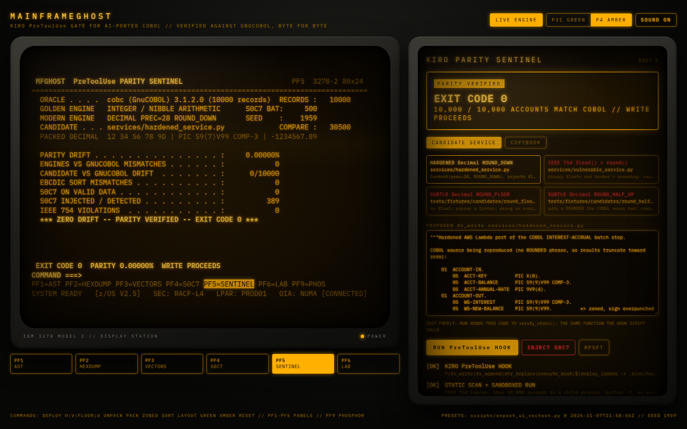
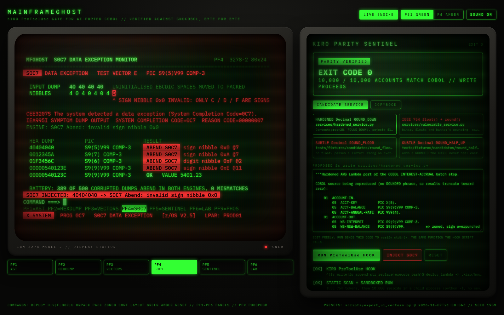
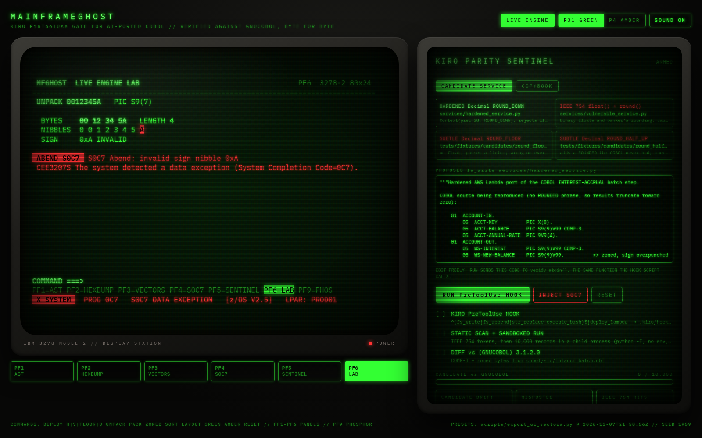

# MainframeGhost

**A Kiro hook that stops an AI agent from writing a COBOL port that gets the money wrong.**

Kiroween 2026 · Category: **Resurrection** · License: Apache-2.0 · Author: Divyanshu Kumar ([@Divyanshu-Kumar14](https://github.com/Divyanshu-Kumar14))



## The problem

Banks still run COBOL batch jobs, and AI agents are now being asked to port them. The dangerous bugs in those ports are not in the business logic. They are in how numbers are stored and rounded:

- COBOL `COMPUTE` without `ROUNDED` truncates toward zero. Python's `round()` uses banker's rounding, `ROUND_FLOOR` rounds negatives the wrong way, and `ROUND_HALF_UP` adds a `ROUNDED` the program never had.
- Packed decimal (`COMP-3`), zoned decimal sign overpunch (`"1234N"` is -12345), `SYNC` slack bytes and the EBCDIC sort order (`a < A < 0`) all have exact byte rules.
- A float linter catches `float()` and `round()`. It does not catch a clean `decimal.Decimal` port with the wrong rounding mode. That port passes code review and positive-balance unit tests, and then misposts a cent on half the accounts.

## What MainframeGhost does

Every time the Kiro agent tries to write a Python file, a `PreToolUse` hook runs the proposed code before it reaches disk:

1. **Static scan.** Token-level check for `float()`, `round()` and float literals.
2. **Sandboxed execution.** The hook rebuilds the post-write file (for `fs_write`, `fs_append` and `str_replace`) and runs its `accrue_monthly_interest` in a child process: `python -I -B`, empty environment (no AWS or Kiro credentials), CPU / memory / file-size limits, 30 s timeout, and no network (`unshare --net`).
3. **Diff against real COBOL output.** The results for 10,000 accounts are compared with what **GnuCOBOL 3.1.2** produced when it ran the original program, [`cobol/src/intaccr_batch.cbl`](cobol/src/intaccr_batch.cbl), which `COPY`s [`copybooks/INTACCR.cpy`](copybooks/INTACCR.cpy). The service also has to reject a `float` argument with `TypeError`.

Any difference means exit code 2. Kiro blocks the write and hands the agent the records that differ, so it can fix the arithmetic and try again.

### Results on the four reference candidates

Produced by the real hook (`scripts/export_ui_vectors.py` re-runs it and refuses to export if the hook and the in-process verdict disagree):

| Candidate | Static scan | Accounts that differ from COBOL | Misposted | Hook |
| :--- | :--- | :--- | :--- | :--- |
| [`services/hardened_service.py`](services/hardened_service.py) `Decimal` + `ROUND_DOWN` | clean | 0 of 10,000 | $0.00 | **exit 0** |
| [`services/vulnerable_service.py`](services/vulnerable_service.py) `float()` + `round()` | 7 violations | 5,383 (53.83%) | $49.37 | **exit 2** |
| [`round_floor.py`](tests/fixtures/candidates/round_floor.py) `Decimal` + `ROUND_FLOOR` | **clean** | 4,962 (49.62%) | $49.62 | **exit 2** |
| [`round_half_up.py`](tests/fixtures/candidates/round_half_up.py) `Decimal` + `ROUND_HALF_UP` | **clean** | 4,937 (49.37%) | $49.37 | **exit 2** |

The two `Decimal` ports in the bold rows are the reason this exists: a static check approves both.

"Misposted" is the sum of `|candidate - COBOL|` over the 10,000 accounts in the seeded test corpus.

## Where Kiro does the work

| Kiro feature | What it does here |
| :--- | :--- |
| **Agent hook** ([`.kiro/hooks/parity_guard.json`](.kiro/hooks/parity_guard.json)) | `PreToolUse` on `fs_write`, `fs_append`, `str_replace` and `execute_bash`. Runs [`verify_modernization_parity.sh`](.kiro/hooks/bin/verify_modernization_parity.sh). Exit 2 blocks the call and returns STDERR to the agent. It fails closed: if the engine is missing, every write is blocked. |
| **Steering** ([`.kiro/steering/cobol_parity.md`](.kiro/steering/cobol_parity.md)) | Always included. Holds the arithmetic rules (Decimal only, `ROUND_DOWN` unless `ROUNDED`, CP-037 sort keys). Steering tells the agent the rules, and the hook checks that it followed them. |
| **Spec** ([`.kiro/specs/mainframe_parity/`](.kiro/specs/mainframe_parity/)) | EARS requirements REQ-MF-001 to 007, a design doc and the task list the build followed. Golden vectors A-E come from [`specs/PRD.md`](specs/PRD.md). |
| **MCP server** ([`.kiro/mcp/server.py`](.kiro/mcp/server.py)) | `mainframe-inspector` (FastMCP, stdio): `inspect_copybook_offsets`, `decode_comp3_hex`, and `run_shadow_parity_check`, which runs the same sandboxed diff as the hook. |
| **Custom agents** ([`.kiro/agents/`](.kiro/agents/)) | `cobol-porter` writes services. It can't touch the hook or the fixtures, and it fixes its own code from veto output. `parity-auditor` is read-only and audits files through the MCP tools. |
| **Skills** ([`.kiro/skills/`](.kiro/skills/)) | COMP-3 / EBCDIC rules, Bedrock patterns, hook authoring, and the 3270 CRT look. |
| **Property-based tests** ([`tests/test_properties.py`](tests/test_properties.py)) | Hypothesis tests: COMP-3 and zoned round trips for every digit count and scale, S0C7 agreement on random bytes, truncation toward zero, EBCDIC sort, REDEFINES write-through, SYNC alignment. |

A live veto from a Kiro session, copied verbatim, is in [`docs/evidence/kiro_live_veto_2026-11-08.json`](docs/evidence/kiro_live_veto_2026-11-08.json). The hook blocked the agent's own attempt to write the float negative control.

## Ground truth: GnuCOBOL

The Python "golden engine" was written by the same author as the code it checks, so on its own it proves nothing about mainframe behaviour. Ground truth comes from a COBOL compiler instead:

```bash
python3 -m engine.cobol_oracle generate   # builds cobol/Dockerfile, runs cobc in --network none
python3 -m engine.cobol_oracle verify     # Python engines vs COBOL bytes, exit 2 on drift
```

The output (`ACCTOUT`: COMP-3 interest and zoned new balance per account; `KEYSOUT`: the COBOL `SORT` result using the EBCDIC alphabet) is committed in [`cobol/fixtures/`](cobol/fixtures/) with SHA-256 digests. Tests, the hook and the cockpit compare against those bytes without needing Docker. A modified fixture counts as drift.

Both Python engines match GnuCOBOL byte for byte on all 10,000 records and on the sort.

**Limits:** GnuCOBOL is not IBM Enterprise COBOL. For this program (one multiply, one divide, truncation on store, COMP-3 and signed zoned output, an EBCDIC sort) the results should be the same, but this has not been checked on z/OS. GnuCOBOL does not raise S0C7, so the S0C7 checks rely on the Python engine. The sandbox is a hardened subprocess, not a VM, so treat it as a guard against accidental damage, not against a determined attacker.

## Amazon Bedrock

[`services/bedrock_transpiler.py`](services/bedrock_transpiler.py) sends the COBOL program to Claude Sonnet 5.5 (`us.anthropic.claude-sonnet-5-5`), with COPY members inlined and the parser's byte layout attached. Every response goes through the same sandboxed diff. If the response fails, nothing is written and the command exits with code 2.

```bash
pip install -e ".[aws]"            # then: aws login, or export AWS_BEARER_TOKEN_BEDROCK
python3 -m services.bedrock_transpiler cobol/src/intaccr_batch.cbl -o services/bedrock_service.py --capture
python3 -m services.bedrock_transpiler cobol/src/intaccr_batch.cbl --naive --capture   # no rules in the prompt
```

`--capture` saves the raw model output and its verdict under `tests/fixtures/candidates/`. The cockpit then shows each capture as one more candidate. Sonnet 5.5 always uses adaptive thinking, so its output isn't deterministic, which is why every response is checked. `--dry-run` prints the request without calling AWS.

## The cockpit

An IBM 3278-2 style 80×24 terminal (React 19 + Vite), backed by the real engine through [`cockpit/server.py`](cockpit/server.py), which uses only the standard library.

```bash
cd ui && npm install && npm run build && cd ..
python3 -m cockpit.server          # http://127.0.0.1:8737
```

- **Sentinel panel:** pick a candidate or edit the code, then press **RUN PreToolUse HOOK**. The code goes to `verify_stdin()`, the same function the hook script calls, and you get the real verdict, drift count and transcript.
- **COPYBOOK tab:** paste any copybook. PF1 shows offsets, REDEFINES and SYNC slack.
- **PF6 LAB:** type commands such as `UNPACK 40404040 S9(5)V99`, `PACK -1234567.89 S9(7)V99`, `ZONED 1234N S9(5)` or `SORT 100ACC ACC100 acc100`.
- PF1-PF5 show the copybook AST, a hex dump, golden vectors, the S0C7 monitor and the sentinel. PF9 switches between green and amber phosphor.

Candidate execution is only enabled when the server listens on loopback. Started with `--host 0.0.0.0` (or as a static build with no API), the UI shows the verdicts exported from the real hook and labels them `PRESET`.

| Live veto of an edited service | Amber, parity verified | S0C7 monitor | Engine lab |
| :---: | :---: | :---: | :---: |
|  |  |  |  |

## Run it

```bash
python3.12 -m venv .venv && source .venv/bin/activate
pip install -e ".[dev]"
pytest                                                          # 100 tests
python3 engine/shadow_fuzzer.py --candidate tests/fixtures/candidates/round_floor.py ; echo $?   # 2
python3 engine/shadow_fuzzer.py --candidate services/hardened_service.py --3270 ; echo $?        # 0
```

Pipe a payload through the hook the way Kiro does:

```bash
python3 -c 'import json; print(json.dumps({"hook_event_name":"PreToolUse","tool_name":"fs_write",
  "tool_input":{"path":"services/ported.py","text":open("tests/fixtures/candidates/round_floor.py").read()}}))' \
  | .kiro/hooks/bin/verify_modernization_parity.sh ; echo $?    # 2, with the first drifting records on stderr
```

Requires Linux or macOS, Python 3.12+ and Node 20+. Docker is only needed to regenerate the COBOL fixtures. The network namespace needs Linux with unprivileged user namespaces; without it the sandbox still applies the other limits and reports that it has no network isolation.

## Layout

```
.kiro/        hooks/, steering/, specs/, agents/, skills/, mcp/server.py, settings/mcp.json
cobol/        src/intaccr_batch.cbl, src/ebcsort.cbl, Dockerfile, fixtures/ (GnuCOBOL output + manifest)
copybooks/    INTACCR.cpy (52-byte record: COMP-3, zoned, SYNC binary, REDEFINES)
engine/       comp3_packer, ebcdic_codec, copybook_parser, shadow_fuzzer, candidate_runner, cobol_oracle
services/     hardened_service (Lambda handler), vulnerable_service (float control), bedrock_transpiler
cockpit/      server.py: JSON API + static host for ui/dist
scripts/      export_ui_vectors.py: runs the real hook on every candidate for the UI presets
tests/        test_parity_engine, test_oracle_and_gate, test_properties; fixtures/candidates/
ui/           3270 cockpit
```

## Scope

One batch step: the monthly interest accrual on one record layout, with its sort. The approach (run the original COBOL once, commit the bytes, then diff every AI-written port against them inside the agent's write path) applies to other programs. Each new program needs its own driver and fixtures.
